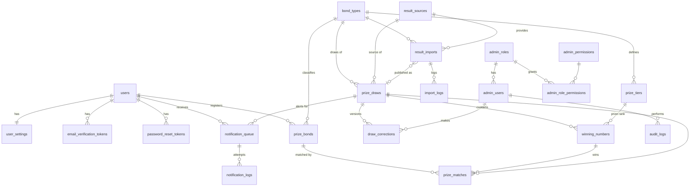

# Entity-relationship diagram

Standalone: `system_settings`, `cron_job_logs`, `job_locks`, `failed_jobs`, `rate_limits`, `migrations`.

Key constraints: `users.email` unique; `prize_bonds (user, type, series, number)` unique; `prize_draws (bond_type, draw_number)` unique;
`winning_numbers (draw, tier, number, series)` unique; `prize_matches (bond, winning_number)` unique (a bond may match several tiers in one draw);
`notification_queue.idempotency_key` unique. Bond numbers are VARCHAR(16) everywhere. All timestamps UTC.
